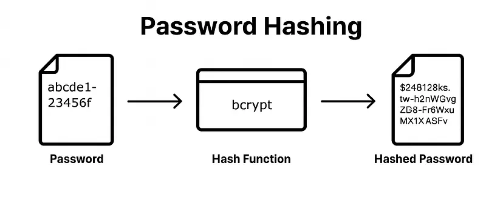
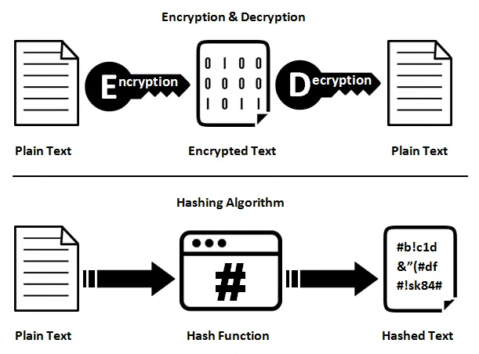

# Como as senhas são armazenadas?

No que diz respeito ao armazenamento seguro de senhas em sistemas de autenticação, o hashing e a criptografia são, por assim dizer, maneiras responsáveis de se fazer isso. Embora ambas possuam o mesmo propósito — transformar os dados em um formato ilegível — e sejam frequentemente confundidas, apresentam diferenças fundamentais tanto em seus princípios quanto em suas aplicações. Em nosso contexto, o objetivo ao armazenar senhas utilizando o hashing ou criptografia é proteger as senhas e, por extensão, os recursos por detrás delas, mesmo diante do comprometimento da aplicação ou do banco de dados que as armazenam e manipulam.

A seguir, veremos uma breve explicação dessas duas abordagens aplicadas ao contexto do armazenamento de senhas, o que fornecerá o background necessário para que seja possível visualizar a relevância do processo de quebra de senhas. Embora pareça um tópico simples, a possibilidade de recuperar uma senha por meio de operações de quebra e o tempo necessário para isso são fortemente impactados pela maneira como a senha é armazenada em um sistema.

&nbsp;

## Hashing

O propósito do hashing, no contexto do armazenamento de senhas, é permitir que a senha de um usuário seja armazenada de forma segura, de modo que ninguém consiga recuperá-la.

O hashing é uma operação que transforma uma entrada (neste caso, a senha do usuário) em uma sequência de caracteres ilegível e de tamanho fixo. Uma das principais características do hashing — o que é também uma das suas principais diferenças em relação a criptografia — é ser unidirecional, ou seja, o dado original não pode ser recuperado a partir do hash gerado. É impossível “descriptografar” um hash e chegar ao dado original, o que é um dos principais motivos do porquê essa abordagem é a mais adequada para o armazenamento de senhas.

&nbsp;

  

&nbsp;

Outra característica do hashing é que uma mesma entrada sempre gerará o mesmo valor de hash; ou seja, o hashing é o que chamamos de determinístico. Isso significa que: mesma entrada = mesmo hash. Uma única alteração na entrada fará com que um hash totalmente diferente seja gerado.

Além disso, com o objetivo de aumentar a segurança, pode-se adicionar um salt, que consiste em incluir uma string aleatória durante a geração do valor de hash. Embora o algoritmo de hashing possa ser o mesmo para várias senhas, o salt é exclusivo para cada uma, o que ajuda a neutralizar ataques de pré-computação, como os Rainbow Table Attacks (Ataques de Tabela Arco-íris), e também impede que senhas iguais resultem no mesmo hash. Algoritmos modernos de hashing, como Argon2id e bcrypt já realizam o salting automaticamente, portanto não são necessárias etapas adicionais ao utilizá-los.

Embora existam muitos algoritmos de hash, cada um deles é projetado com objetivos e aplicações diferentes. Algumas características tornam alguns mais apropriados para garantir a integridade de dados, enquanto outros são projetados especificamente para o armazenamento seguro de senhas.

Algoritmos de hash podem variar em diversos aspectos, como no tamanho da saída, no custo computacional para a geração do hash (work factor), no modo como lidam com salting, no consumo de memória, na velocidade de execução, etc. A escolha de um algoritmo apropriado para o armazenamento de senhas, como mencionado anteriormente, é de extrema importância e pode determinar a possibilidade — ou não — da recuperação de uma senha por meio de ataques de quebra.

Sobre o processo de autenticação com hashing, este ocorre basicamente da seguinte forma: a senha fornecida pelo usuário é usada para gerar um hash, que é então comparado com o hash armazenado (hash da senha criada anteriormente pelo usuário). Se os hashes coincidirem, o acesso é permitido; caso contrário, a senha está incorreta e o acesso é negado.

O hashing corretamente implementado garante que a senha em texto simples jamais seja manipulada pelo sistema após sua criação e torna extremamente difícil a recuperação da senha em texto claro por meio de ataques de quebra, caso ela seja comprometida.

Como dito, existem algoritmos de hash projetados especificamente para tornar o armazenamento de senhas mais seguro e dificultar sua recuperação por meio de ataques de quebra. Esses algoritmos devem ser tão lentos quanto for possível suportar, isto é, sem que a experiência dos usuários e a performance do sistema sejam prejudicadas. alguns algoritmos modernos se destacam nesse caso, como Argon2id, scrypt, bcrypt e PBKDF2.

&nbsp;

## Criptografia

A criptografia é a arte de transformar informações legíveis em um formato ilegível, de modo que apenas quem possua a chave de descriptografia correta possa recuperar o conteúdo original.

Uma das principais diferenças entre hashing e criptografia é que, na criptografia, os dados originais podem ser recuperados a partir do texto cifrado, enquanto no hashing, como mencionado anteriormente, isso não é possível. A operação, nesse caso, é denominada bidirecional.

Para realizar o processo de criptografia e descriptografia, uma ou mais chaves de criptografia são geradas e utilizadas, dependendo da abordagem de criptografia utilizada. Esse artigo não tratará o conceito de criptografia a fundo, entendê-lo melhor aqui: [What is encryption?](https://www.ibm.com/topics/encryption)

&nbsp;

  

&nbsp;

Com respeito ao armazenamento seguro de senhas, a criptografia apresenta algumas desvantagens. A principal delas, como você já deve imaginar, é que o texto original pode ser recuperado a partir do produto cifrado. Em outras palavras, qualquer pessoa que obtiver acesso ao texto cifrado e à chave correta poderá recuperar a senha em texto simples. Assim, a criptografia implica questões como a gestão segura das chaves (quem as guarda e manipula, e como são protegidas). Nesse caso, se a chave vazar, o agente poderá decifrar todos os dados criptografados.

Na autenticação com senhas criptografadas, o texto cifrado pode ser comparado diretamente, de maneira semelhante a abordagem com hashing, ou a senha pode ser descriptografada para validação da senha fornecida pelo usuário.

Apesar da menção a criptografia como um meio de armazenamento “responsável” de senhas, essa abordagem não é a mais recomendada por organizações de referência em segurança da informação, como o NIST e OWASP, que recomendam fortemente o uso de hashing + salting. (OWASP Password Storage Cheat Sheet — Background, “Hashing vs Encryption”): [Password Storage Cheat Sheet](https://cheatsheetseries.owasp.org/cheatsheets/Password_Storage_Cheat_Sheet.html).

---

[Índice da pesquisa](../../README.md#%C3%ADndice)
